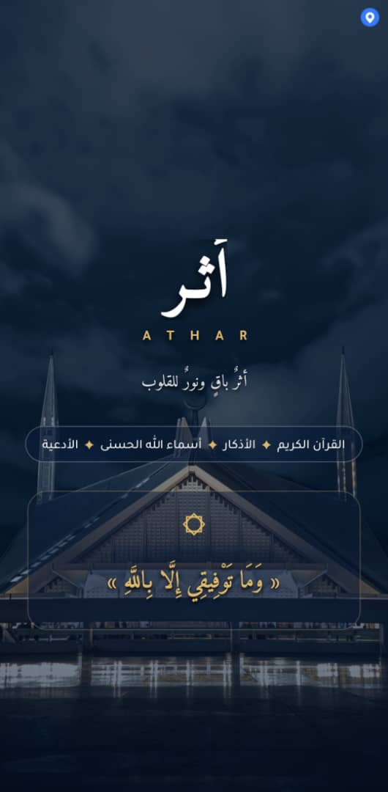
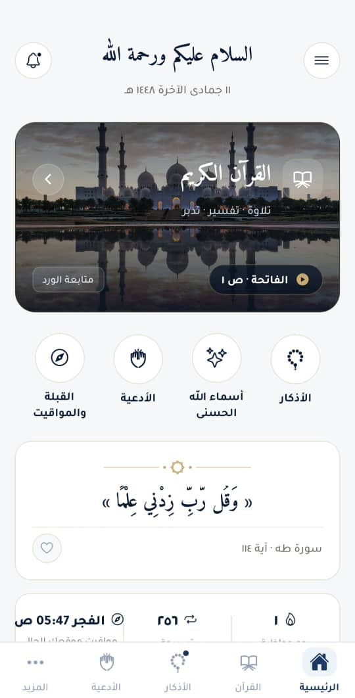
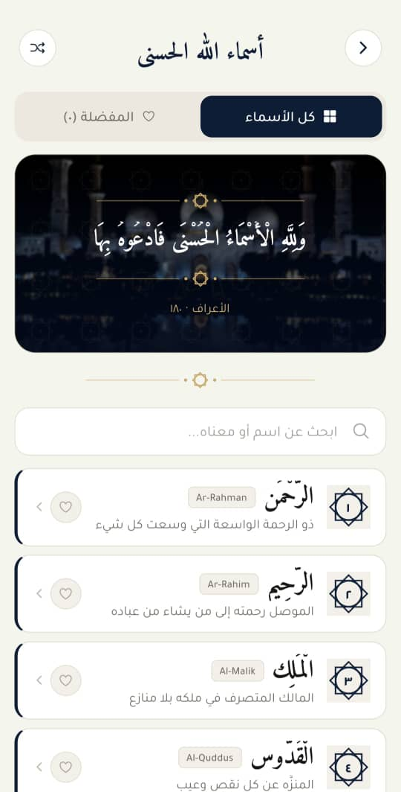
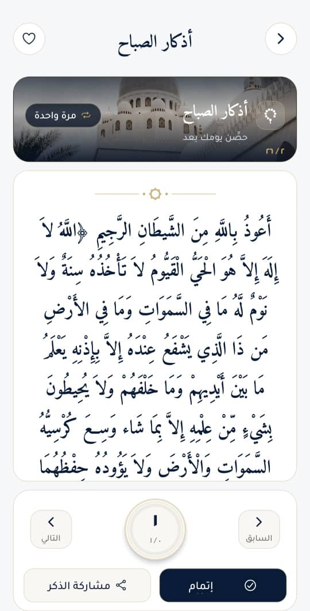
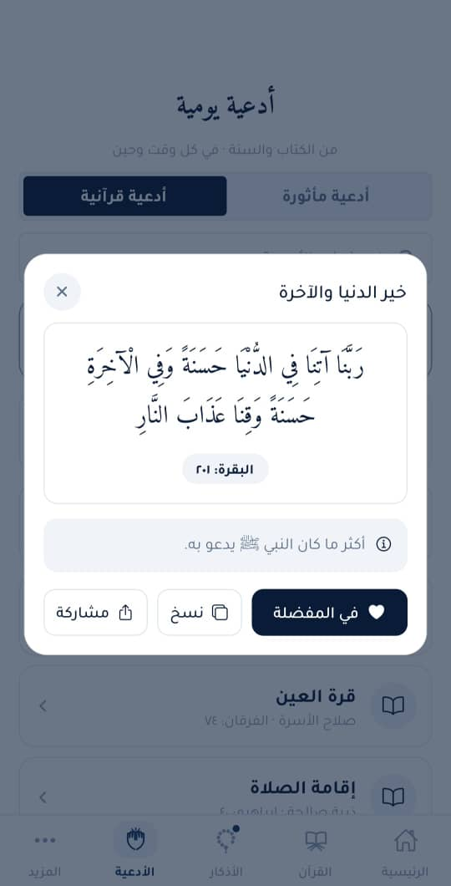

# أثر (Ather)

أثر تطبيق إسلامي عربي وهادئ مبني بـ Expo وReact Native، يجمع القرآن الكريم والأذكار والأدعية وأسماء الله الحسنى والقبلة ومواقيت الصلاة في تجربة دون حسابات أو إعلانات وتركز على الخصوصية والعمل دون اتصال.

## Main Features

- Full Quran with 114 surahs and 6,236 verses, Uthmanic Hafs font, page/juz metadata, favorites, search, and continuous or swipe reading.
- Full-surah audio and per-ayah recitation, with a persistent mini-player.
- Morning and evening adhkar, interactive counters, daily progress, streak tracking, duas, and favorites.
- All 99 Names of Allah with Arabic names, meanings, transliteration, and search.
- GPS-assisted or manually selected location for prayer times and Qibla direction.
- Prayer methods, Asr calculation choices, 12/24-hour time, Hijri date adjustment, compass, and manual dial.
- Arabic RTL interface, light and dark themes, local persistence, and a responsive phone-width web layout.

## Stack

- Expo SDK 58
- React Native 0.88
- React 19
- TypeScript 6
- expo-router
- AsyncStorage
- expo-audio
- expo-location
- expo-sensors
- react-native-svg
- React Native Web

## Architecture

The app has no accounts, backend, or multi-tenant service. Each installation is isolated by the device's AsyncStorage storage. The Store provider merges persisted settings and favorites with defaults, while Location and Player providers manage GPS state and audio.

Religious text is bundled in `src/quran.json` and `src/azkar.json`, so reading flows work offline. There is no AI answer pipeline: Quran and adhkar pages read generated local datasets, while prayer times, Hijri dates, and Qibla bearings are calculated on-device from bundled astronomy helpers and a selected city or GPS fix.

The file structure follows expo-router:

```text
app/       Screens and tabs
src/       Store, data, location, player, theme, UI, and calculations
assets/    Quran font and mosque imagery
scripts/   Deterministic Quran and adhkar data generators
dist/      Static web build
```

## Setup

Requirements:

- Node.js 20 or newer
- npm or pnpm
- Android Studio, Xcode, or an Expo-capable browser

```bash
git clone https://github.com/shaimaa-babiker/Ather.git
cd Ather
npm install
npx expo start
```

Expo shortcuts:

- `w` — web
- `a` — Android
- `i` — iOS

Build the static web app:

```bash
npm run build:web
```

Type-check the project:

```bash
npx tsc --noEmit
```

For the data-generation scripts:

```bash
npm run fetch:quran
npm run fetch:azkar
```

## Screenshots

<p align="center">
  
  
  
  
  
  
  
</p>

## Live Demo

The repository does not currently publish a live GitHub Pages deployment. A web build can be produced and served locally with:

```bash
npm run build:web
npx serve dist
```

## Data and Privacy

- Quran text comes from the King Fahd Complex's Uthmanic Hafs 13.0 dataset.
- Adhkar data comes from the official Hisn al-Muslim source.
- Location is optional and stored on the device only.
- No accounts, analytics, ads, tracking, or cloud synchronization are included.
- Only streamed recitation audio normally requires a network connection.

For sources, provenance, and religious-content caveats, see [REFERENCES.md](REFERENCES.md).
